  

 

## 🧪 Sobre mí

Soy **físico de la Universidad Industrial de Santander**. Mi trabajo consiste en **simular sistemas cuánticos**: resolver la ecuación de Schrödinger para entender dónde se localiza un electrón cuando lo confinas, cómo responde a un campo eléctrico y qué le pasa cuando lo pones al lado de una impureza.

Mi herramienta principal es la **aproximación de masa efectiva** junto con **elementos finitos (COMSOL)**, apoyada en Python para el análisis y LaTeX para escribir la física sin ruido.

- 🎓 Tesis de pregrado **laureada (5.0)** — Universidad Industrial de Santander.
- 🛰️ Ponencia en el **XXX Congreso Nacional de Física (2025)**.
- 🐧 Trabajo a diario en **Debian Linux**, con Python, LaTeX y Git.

 

## ⚛️ Tesis

> **Efecto de una impureza donadora sobre las propiedades optoelectrónicas de una cadena lineal de puntos cuánticos**
>
> Cadena de cinco puntos cuánticos de GaAs/Al₀.₃Ga₀.₇As · impureza hidrogenoide · campo eléctrico externo · elementos finitos.

| | |
|:--|:--|
| **Autor** | Daniel Parra Parra |
| **Director** | Dr. Willian Gutiérrez Niño |
| **Resultado** | Laureada · 5.0 |
| **Repositorio** | [Tesis-Pregrado-UIS-Puntos-Cuanticos](https://github.com/danielparra2/Tesis-Pregrado-UIS-Puntos-Cuanticos) |

 

## 🔬 Qué simulo

- **Localización electrónica** en cadenas de puntos cuánticos acoplados.
- **Impurezas hidrogenoides** y su efecto sobre los niveles de energía.
- **Anticruces** entre sub-bandas al variar el tamaño de un punto.
- **Respuesta optoelectrónica**: estructura de niveles y posición de las líneas de absorción.
- **Campos eléctricos** y el corrimiento de los estados confinados.

 

## 🛠️ Herramientas

  
  
  
  
  
  
  
  
  

 

## 🐱 El gato de Schrödinger

  

Un sistema cuántico no está en un estado ni en el otro: está en la **superposición** de ambos. Solo al medir se elige una rama. Es la misma idea que hay detrás de mis cálculos: no impongo dónde está el electrón, dejo que el Hamiltoniano decida.

 

## 🚧 Simulaciones

> **Espacio reservado.** Aquí van las simulaciones y visualizaciones del laboratorio: paquetes de onda, efecto túnel, orbitales y cadenas de puntos cuánticos.
>
> Por ahora, el resultado que sí está publicado es la [tesis](https://github.com/danielparra2/Tesis-Pregrado-UIS-Puntos-Cuanticos).

 

## 🛰️ Congreso

**XXX Congreso Nacional de Física (2025)** — ponencia en póster:
*Efecto de una impureza donadora sobre las propiedades optoelectrónicas de una cadena lineal de puntos cuánticos*.

 

## 📫 Contacto

Solo GitHub: [@danielparra2](https://github.com/danielparra2)

 

---

  <i>"Nature isn't classical, dammit, and if you want to make a simulation of nature, you'd better make it quantum mechanical."</i> — Richard Feynman, <i>Simulating Physics with Computers</i> (1981)

