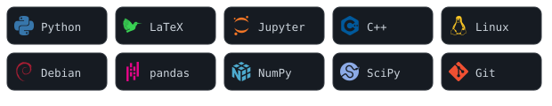

  

  

   <b>CURRENTLY LEARNING</b> — Data Science @ GCI World 2026 (University of Tokyo) · AI for Science

> [!TIP]
> **ABOUT ME**
>
> Computational physicist (UIS, degree in process). **Laureate thesis.** I build physics-based simulations and data-driven models: quantum systems with **FEM and Python**, chaotic dynamics, and **neural networks that respect physics**.
>
> Currently in **GCI World 2026 — Data Science at the University of Tokyo**. Self-taught in Python, Linux, LaTeX and C++; always building and learning.
>
> **Laureate thesis · 398 h certified teaching · 6 projects · GCI World 2026**

> [!NOTE]
> **EXPERIENCE & EDUCATION**
>
> **Experience**
> - **Teaching Assistant & Tutor — UIS (2024–2026).** SEA-MIDAS: 398 h of tutoring in Thermodynamics and Physics I–III. Private tutoring in math and physics since 2019.
> - **Teaching Assistant in Mathematics — Colegio Centro de Comercio (2017).** 80 h of supervised practice.
>
> **Education**
> - **BSc in Physics — Universidad Industrial de Santander** (degree in process).
> - **Laureate thesis:** *Effect of a donor impurity on the optoelectronic properties of a linear quantum dot chain.*
> - **GCI World 2026 — Data Science, University of Tokyo** (in progress).
>
> **Self-taught**
> - Python, Linux, LaTeX, C++ and scientific computing — learned through independent projects and self-study.
>
> **Recognition & certificates**
> - Laureate thesis — UIS, 2026.
> - Talk at XXX Congreso Nacional de Física (2025).
> - SEA-MIDAS certificate — 398 h (2024–2026).
> - GCI World 2026 — Data Science (in progress).

> [!TIP]
> **PROJECTS**
>
> - **Thesis — quantum dot chain (GaAs/AlGaAs).** FEM simulation of a donor impurity in a five-dot chain under an electric field: level structure, anticrossings and absorption.
> - **Physics-informed neural networks (PINNs/HNN).** JAX/GPU models for physics-constrained learning and chaotic dynamics (pendulum).
> - **Double pendulum & chaos.** Phase space, bifurcation and sensitivity to initial conditions, with numerical integration and animations.
> - **Meteorological data analysis.** Arduino weather station: atmospheric pressure time series (2023), cleaning, trends and visualization (Thermodynamics).
> - **Quantum simulations.** Wave packet dynamics, finite potential well and hydrogen atom (radial functions/orbitals).
> - **Parallel Monte Carlo — charged ring.** Electric field of a charged ring via Monte Carlo integration with parallelization (C++/Python).

> [!IMPORTANT]
> **CONTACT**
>
> - **Email:** [sasukeda25@gmail.com](mailto:sasukeda25@gmail.com)
> - **GitHub:** [@danielparra2](https://github.com/danielparra2)
> - Open to junior data science and AI-for-Science roles.
